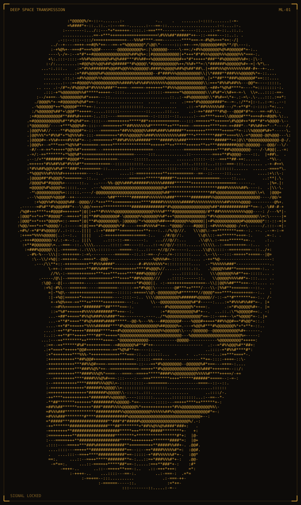

<p align="center">
  <picture>
    <source media="(prefers-color-scheme: dark)" srcset="ascii-portrait-dark.svg">
    <source media="(prefers-color-scheme: light)" srcset="ascii-portrait-light.svg">
    
  </picture>
</p>

<h1 align="center">Mateus Lino</h1>

<p align="center">
  BI Analyst and Creative Developer<br>
  Co-founder, Turingui
</p>

## Transmission

```text
SIGNAL   incoming
FROM     Frutal, Minas Gerais, Brazil
SUBJECT  data into decisions, and the web tools around them
```

I turn data into decisions people can act on, and build the web tools around them. BI at Sicoob by day; web platforms, research and a studio of my own by choice.

## Mission record

| Period | Role and place |
| --- | --- |
| Nov 2025 to now | BI Analyst, Sicoob Frutal |
| 2025 | BSc Information Systems, UEMG |
| Two years | Data analysis and IT governance intern, Cervejaria Cidade Imperial |
| Now | Co-founder, [Turingui](https://turingui.com) |

At Sicoob I built the credit-risk report in Power BI (provisioning scenarios, Basel indicators) and cut its refresh time by 90%. Python automations save about a workday a week.

### Research

First author of the paper on RedeAgromet, a public weather-data platform for the Southern Triângulo Mineiro that began as my undergraduate research. Presented at CBAgro 2025; published in Revista Agrogeoambiental in 2026.

[doi.org/10.18406/2316-1817v18nunico20262109](https://doi.org/10.18406/2316-1817v18nunico20262109)

## Strengths

Power BI, SQL and Python on the data side. TypeScript, React and Next.js on the web side. Three.js when a page needs depth. Certified: Microsoft PL-300, ANBIMA CPA.

## Selected work

| Project | What it is |
| --- | --- |
| [RedeAgromet](https://www.redeagromet.com.br) | Public agrometeorological data platform. The first large system I built alone. |
| [AggriON](https://www.mateuslino.com/builds/aggrion/) | Credit analysis prototype for businesses that sell on credit. Co-founded. Fictional data. |
| [Veranila](https://www.mateuslino.com/builds/veranila/) | Irrigation management prototype. First of 12 teams (score 96) in SEBRAE Fator S Pré-Acelera. |
| [Lino's Binaural](https://github.com/LipeLino/linosbinaural) | Free browser listening room. Binaural tones from the Web Audio API. No account, no tracking. |
| [mateuslino.com](https://www.mateuslino.com) | This portfolio as a navigable 3D solar system. Source is private. |

## Contact

[Portfolio](https://www.mateuslino.com) | [LinkedIn](https://www.linkedin.com/in/mateusflino/) | [Turingui](https://turingui.com) | [Contra](https://contra.com/mateus_lino_6bzvvru2) | [ORCID](https://orcid.org/0009-0005-8677-0560) | [ResearchGate](https://www.researchgate.net/profile/Mateus-Lino)
