
<a href="https://www.mateuslino.com" title="Mateus Lino: open mateuslino.com"><picture>
<source media="(prefers-color-scheme: dark) and (max-width: 600px)" srcset="assets/m/hero-dark.svg">
<source media="(prefers-color-scheme: light) and (max-width: 600px)" srcset="assets/m/hero-light.svg">
<source media="(prefers-color-scheme: dark)" srcset="assets/hero-dark.svg">
<source media="(prefers-color-scheme: light)" srcset="assets/hero-light.svg">

</picture></a>

BI analyst at Sicoob. I build the tools around the numbers. Building [Turingui](https://turingui.com), a digital experience studio.

<picture>
<source media="(prefers-color-scheme: dark) and (max-width: 600px)" srcset="assets/m/focus-dark.svg">
<source media="(prefers-color-scheme: light) and (max-width: 600px)" srcset="assets/m/focus-light.svg">
<source media="(prefers-color-scheme: dark)" srcset="assets/focus-dark.svg">
<source media="(prefers-color-scheme: light)" srcset="assets/focus-light.svg">

</picture>
<picture>
<source media="(prefers-color-scheme: dark) and (max-width: 600px)" srcset="assets/m/languages-dark.svg">
<source media="(prefers-color-scheme: light) and (max-width: 600px)" srcset="assets/m/languages-light.svg">
<source media="(prefers-color-scheme: dark)" srcset="assets/languages-dark.svg">
<source media="(prefers-color-scheme: light)" srcset="assets/languages-light.svg">

</picture>

<picture>
<source media="(prefers-color-scheme: dark) and (max-width: 600px)" srcset="assets/m/experience-dark.svg">
<source media="(prefers-color-scheme: light) and (max-width: 600px)" srcset="assets/m/experience-light.svg">
<source media="(prefers-color-scheme: dark)" srcset="assets/experience-dark.svg">
<source media="(prefers-color-scheme: light)" srcset="assets/experience-light.svg">

</picture>

More detail

- **BI Analyst, Sicoob Frutal (Nov 2025 to now).** Built the credit-risk report in Power BI (provisioning scenarios, Basel indicators) and cut its refresh time by 90%. Python automations save about a workday a week.
- **Co-founder and developer, Veranila (Aug 2026 to now).** SEBRAE Fator S Pré-Acelera. Weather-informed irrigation prototype. The team placed first of 12 in the selection, with a score of 96.
- **Web Developer, Avance Consultoria Júnior (Apr 2024 to Apr 2025).** UEMG. Built about half of a live website and custom CMS for a communications agency.
- **Data Analyst (intern), Cervejaria Cidade Imperial (Sep 2023 to Sep 2025).** Dashboards, SQL ticket analysis and IT governance with ITIL and COBIT.

<picture>
<source media="(prefers-color-scheme: dark) and (max-width: 600px)" srcset="assets/m/stack-head-dark.svg">
<source media="(prefers-color-scheme: light) and (max-width: 600px)" srcset="assets/m/stack-head-light.svg">
<source media="(prefers-color-scheme: dark)" srcset="assets/stack-head-dark.svg">
<source media="(prefers-color-scheme: light)" srcset="assets/stack-head-light.svg">
</picture>

<picture>
<source media="(prefers-color-scheme: dark) and (max-width: 600px)" srcset="assets/m/stack-data-dark.svg">
<source media="(prefers-color-scheme: light) and (max-width: 600px)" srcset="assets/m/stack-data-light.svg">
<source media="(prefers-color-scheme: dark)" srcset="assets/stack-data-dark.svg">
<source media="(prefers-color-scheme: light)" srcset="assets/stack-data-light.svg">

</picture>
<a href="https://www.mateuslino.com" title="Power BI"></a>
<a href="https://www.mateuslino.com" title="SQL"></a>
<a href="https://www.mateuslino.com" title="Python"></a>
<a href="https://www.mateuslino.com" title="Excel"></a>
<a href="https://www.mateuslino.com" title="Deneb (Vega-Lite)"></a>

<picture>
<source media="(prefers-color-scheme: dark) and (max-width: 600px)" srcset="assets/m/stack-web-dark.svg">
<source media="(prefers-color-scheme: light) and (max-width: 600px)" srcset="assets/m/stack-web-light.svg">
<source media="(prefers-color-scheme: dark)" srcset="assets/stack-web-dark.svg">
<source media="(prefers-color-scheme: light)" srcset="assets/stack-web-light.svg">

</picture>
<a href="https://www.mateuslino.com" title="TypeScript"></a>
<a href="https://www.mateuslino.com" title="React"></a>
<a href="https://www.mateuslino.com" title="Next.js"></a>
<a href="https://www.mateuslino.com" title="Tailwind CSS"></a>
<a href="https://www.mateuslino.com" title="Node.js"></a>

<picture>
<source media="(prefers-color-scheme: dark) and (max-width: 600px)" srcset="assets/m/stack-3d-dark.svg">
<source media="(prefers-color-scheme: light) and (max-width: 600px)" srcset="assets/m/stack-3d-light.svg">
<source media="(prefers-color-scheme: dark)" srcset="assets/stack-3d-dark.svg">
<source media="(prefers-color-scheme: light)" srcset="assets/stack-3d-light.svg">

</picture>
<a href="https://www.mateuslino.com" title="Three.js"></a>
<a href="https://www.mateuslino.com" title="React Three Fiber"></a>
<a href="https://www.mateuslino.com" title="GSAP"></a>

<picture>
<source media="(prefers-color-scheme: dark) and (max-width: 600px)" srcset="assets/m/stack-cloud-dark.svg">
<source media="(prefers-color-scheme: light) and (max-width: 600px)" srcset="assets/m/stack-cloud-light.svg">
<source media="(prefers-color-scheme: dark)" srcset="assets/stack-cloud-dark.svg">
<source media="(prefers-color-scheme: light)" srcset="assets/stack-cloud-light.svg">

</picture>
<a href="https://www.mateuslino.com" title="Supabase"></a>
<a href="https://www.mateuslino.com" title="PostgreSQL"></a>
<a href="https://www.mateuslino.com" title="AWS"></a>
<a href="https://www.mateuslino.com" title="Vercel"></a>

<a href="https://doi.org/10.18406/2316-1817v18nunico20262109" title="Research: open the paper (DOI)"><picture>
<source media="(prefers-color-scheme: dark) and (max-width: 600px)" srcset="assets/m/research-dark.svg">
<source media="(prefers-color-scheme: light) and (max-width: 600px)" srcset="assets/m/research-light.svg">
<source media="(prefers-color-scheme: dark)" srcset="assets/research-dark.svg">
<source media="(prefers-color-scheme: light)" srcset="assets/research-light.svg">

</picture></a>

More detail

First author of the paper on RedeAgromet, a public agrometeorological data platform for the Southern Triângulo Mineiro that began as my undergraduate research. Presented at CBAgro 2025 in Porto Alegre and published in Revista Agrogeoambiental (2026). DOI: [10.18406/2316-1817v18nunico20262109](https://doi.org/10.18406/2316-1817v18nunico20262109).

<picture>
<source media="(prefers-color-scheme: dark) and (max-width: 600px)" srcset="assets/m/work-head-dark.svg">
<source media="(prefers-color-scheme: light) and (max-width: 600px)" srcset="assets/m/work-head-light.svg">
<source media="(prefers-color-scheme: dark)" srcset="assets/work-head-dark.svg">
<source media="(prefers-color-scheme: light)" srcset="assets/work-head-light.svg">

</picture>

<a href="https://www.redeagromet.com.br" title="RedeAgromet: open the live platform"><picture>
<source media="(prefers-color-scheme: dark) and (max-width: 600px)" srcset="assets/m/work-redeagromet-dark.svg">
<source media="(prefers-color-scheme: light) and (max-width: 600px)" srcset="assets/m/work-redeagromet-light.svg">
<source media="(prefers-color-scheme: dark)" srcset="assets/work-redeagromet-dark.svg">
<source media="(prefers-color-scheme: light)" srcset="assets/work-redeagromet-light.svg">

</picture></a>
<a href="https://www.mateuslino.com/builds/veranila/" title="Veranila: open the build page on mateuslino.com"><picture>
<source media="(prefers-color-scheme: dark) and (max-width: 600px)" srcset="assets/m/work-veranila-dark.svg">
<source media="(prefers-color-scheme: light) and (max-width: 600px)" srcset="assets/m/work-veranila-light.svg">
<source media="(prefers-color-scheme: dark)" srcset="assets/work-veranila-dark.svg">
<source media="(prefers-color-scheme: light)" srcset="assets/work-veranila-light.svg">

</picture></a>
<a href="https://www.mateuslino.com/builds/aggrion/" title="AggriON: open the build page on mateuslino.com"><picture>
<source media="(prefers-color-scheme: dark) and (max-width: 600px)" srcset="assets/m/work-aggrion-dark.svg">
<source media="(prefers-color-scheme: light) and (max-width: 600px)" srcset="assets/m/work-aggrion-light.svg">
<source media="(prefers-color-scheme: dark)" srcset="assets/work-aggrion-dark.svg">
<source media="(prefers-color-scheme: light)" srcset="assets/work-aggrion-light.svg">

</picture></a>
<a href="https://github.com/LipeLino/linosbinaural" title="Lino's Binaural: open the repository on GitHub"><picture>
<source media="(prefers-color-scheme: dark) and (max-width: 600px)" srcset="assets/m/work-binaural-dark.svg">
<source media="(prefers-color-scheme: light) and (max-width: 600px)" srcset="assets/m/work-binaural-light.svg">
<source media="(prefers-color-scheme: dark)" srcset="assets/work-binaural-dark.svg">
<source media="(prefers-color-scheme: light)" srcset="assets/work-binaural-light.svg">

</picture></a>
<a href="https://www.mateuslino.com" title="mateuslino.com: open the portfolio"><picture>
<source media="(prefers-color-scheme: dark) and (max-width: 600px)" srcset="assets/m/work-site-dark.svg">
<source media="(prefers-color-scheme: light) and (max-width: 600px)" srcset="assets/m/work-site-light.svg">
<source media="(prefers-color-scheme: dark)" srcset="assets/work-site-dark.svg">
<source media="(prefers-color-scheme: light)" srcset="assets/work-site-light.svg">

</picture></a>
<a href="https://www.mateuslino.com" title="More work: open mateuslino.com"><picture>
<source media="(prefers-color-scheme: dark) and (max-width: 600px)" srcset="assets/m/work-more-dark.svg">
<source media="(prefers-color-scheme: light) and (max-width: 600px)" srcset="assets/m/work-more-light.svg">
<source media="(prefers-color-scheme: dark)" srcset="assets/work-more-dark.svg">
<source media="(prefers-color-scheme: light)" srcset="assets/work-more-light.svg">
</picture></a>

Text version

I'm a BI analyst at Sicoob, Brazil's largest cooperative financial system, and a developer who builds the tools around the numbers. My reports inform the board's decisions; my automations and internal apps take manual work off the teams. Outside the bank I build web platforms, publish research and am building [Turingui](https://turingui.com), a digital experience studio: websites, stores and apps that lift a brand and move a business forward.

**Focus.**
- Business intelligence: Power BI models, DAX and SQL that people use to decide, not just to look at.
- Web platforms: Next.js and Supabase apps with real users, from a public weather-data service to internal tools.
- Interactive 3D: Three.js and React Three Fiber when a page is better explored than scrolled. My portfolio is a solar system you fly through.

**Experience.**
- Nov 2025 to now: BI Analyst, Sicoob Frutal. Built the credit-risk report in Power BI (provisioning scenarios, Basel indicators) and cut its refresh time by 90%. Python automations save about a workday a week.
- Aug 2026 to now: Co-founder and developer, Veranila, SEBRAE Fator S Pré-Acelera. Weather-informed irrigation prototype. The team placed first of 12 in the selection, with a score of 96.
- Apr 2024 to Apr 2025: Web Developer, Avance Consultoria Júnior (UEMG). Built about half of a live website and custom CMS for a communications agency.
- Sep 2023 to Sep 2025: Data Analyst (intern), Cervejaria Cidade Imperial. Dashboards, SQL ticket analysis and IT governance with ITIL and COBIT.

**Teaching.** The Power BI minicourse "Smart dashboards: Netflix data in Power BI" (UEMG and SEBRAE, 2025), and computing as a volunteer teacher at Guarda Mirim de Frutal (2024).

**Education.**
- 2022 to 2025: BSc Information Systems, UEMG Frutal. Thesis on RedeAgromet, approved in December 2025.
- 2024 to 2025: Undergraduate research scholarship, FAPEMIG and UEMG. Agrometeorology and web platforms.
- 2018 to 2021: Technical diploma in Food Science, IFSP Barretos, integrated with high school.

**Certifications and tests.** Microsoft PL-300 (Power BI Data Analyst) and ANBIMA CPA. POSCOMP 2025: 46 of 70, against a national average of 35.4.

**Stack.** Data and BI: Power BI, SQL, Python, Excel, Deneb (Vega-Lite). Web: TypeScript, React, Next.js, Tailwind CSS, Node.js. 3D and motion: Three.js, React Three Fiber, GSAP. Cloud and data stores: Supabase, PostgreSQL, AWS, Vercel.

**Research.** First author of the paper on RedeAgromet, a public agrometeorological data platform for the Southern Triângulo Mineiro that began as my undergraduate research. Presented at CBAgro 2025 in Porto Alegre and published in Revista Agrogeoambiental (2026). DOI: [10.18406/2316-1817v18nunico20262109](https://doi.org/10.18406/2316-1817v18nunico20262109).

**Selected work.**
- [RedeAgromet](https://www.redeagromet.com.br): public weather-data platform with station quality control, FAO-56 evapotranspiration and open exports. My first large system, built alone.
- [Veranila](https://www.mateuslino.com/builds/veranila/): tells a farmer when and how much to irrigate, from the weather on their own farm.
- [AggriON](https://www.mateuslino.com/builds/aggrion/): credit-analysis prototype for businesses that sell on credit. Fictional data.
- [Lino's Binaural](https://github.com/LipeLino/linosbinaural): a free listening room in the browser. Binaural tones from the Web Audio API, no account, no tracking.
- [mateuslino.com](https://www.mateuslino.com): my CV as a navigable 3D solar system, with its own design system and CMS.

**Languages.** Portuguese (native), English (C2), German (A2), Italian (A2).

